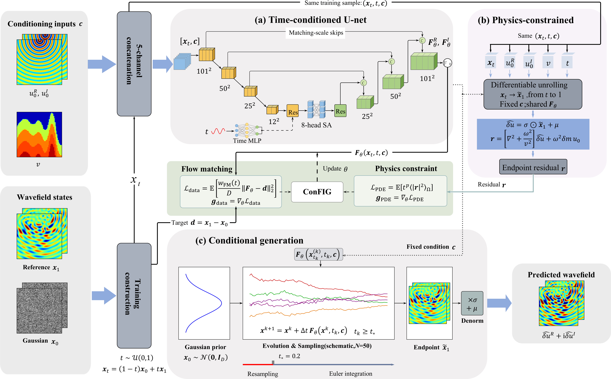

# PBFM-for-wavefield-prediction

This project uses PBFM for frequency-domain seismic wavefield prediction, combining flow matching with Helmholtz equation constraints to predict scattered wavefields under varying velocity models, frequencies, and source locations. It includes data generation, model training, inference, visualization, and comparative evaluation against FNO and GNO.

## Framework

Overview of the PBFM framework for frequency-domain seismic wavefield prediction
